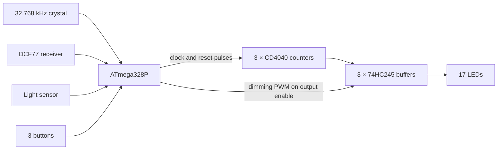

# Binary Clock

[](https://github.com/henry781/binary-clock/actions/workflows/ci.yml)
[](LICENSE)

A wall clock that shows the time in pure binary on 17 LEDs. It keeps time
with a 32.768 kHz watch crystal, sets itself from the DCF77 radio time
signal and dims its LEDs with the light of the room. Through-hole parts
(the DCF77 receiver module aside), on a round 180 mm board that is the
face of the clock.

> **Disclaimer:** this is a personal study project, shared as is in the
> hope that it is useful. It comes with no warranty and no support; build
> and use it at your own risk.

## Features

- **Display**: 17 LEDs, 10 mm: 5 red for the hours, 6 green for the
  minutes, 6 blue for the seconds. The time is held by three CD4040
  counters and shown through three 74HC245 buffers, with no multiplexing.
- **Timekeeping**: ATmega328P, Timer2 in asynchronous mode on a
  32.768 kHz crystal, CPU on its internal 8 MHz oscillator.
- **DCF77 synchronization**: a noise-tolerant software decoder that
  integrates the time over several minutes and follows DST changes and
  leap seconds. It never loaded a wrong time in 6,000 hours of simulated
  noisy signals; the rare corner cases are described in the
  [decoder documentation](docs/dcf77-decoder.md#validation).
- **Automatic dimming**: TEPT5700 light sensor, 488 Hz PWM in 2048 steps,
  from 0.1 % in the dark to full brightness in daylight.
- **Setting by hand**: three buttons, hours +1, minutes +1, seconds to 0.
- **Power**: 5 V from a cable coming out of the wall, on a screw terminal,
  with reverse-polarity protection; about 25 mA in a lit room.
- **Tested**: the decoder runs in a PC simulator against synthetic noise
  and a noise model fitted to recordings of the real receiver; CI builds
  the firmware and runs the regression suite.

Hardware revision B has been built and tested with this firmware.

## Reading the clock

Each row is a binary number, with weights increasing from left to right
as printed on the board. For 14:37:05:

```
             1  2  4  8  16 32
HOURS        ○  ●  ●  ●  ○          2 + 4 + 8  = 14
MINUTES      ●  ○  ●  ○  ○  ●       1 + 4 + 32 = 37
SECONDS      ●  ○  ●  ○  ○  ○       1 + 4      =  5
```

## How it works



Every second, Timer2 wakes the microcontroller, which sends a clock pulse
to the seconds counter and carries into the minutes and hours counters.
The counter outputs drive the LEDs through the buffers; the
microcontroller dims them all at once by switching the buffers' output
enable at 488 Hz with a duty cycle that follows the room light. When a
DCF77 time is confirmed, the firmware reloads the counters and re-aligns
the phase of its seconds on the top of the minute.

## Repository layout

| Path | Content |
|------|---------|
| [`hardware/`](hardware) | KiCad 10 project (schematic, PCB, project libraries) and bill of materials |
| [`firmware/binary_clock/`](firmware/binary_clock) | clock firmware, an Arduino sketch for MiniCore |
| [`firmware/test/`](firmware/test) | PC simulator and regression tests of the DCF77 decoder |
| [`firmware/tools/`](firmware/tools) | bring-up sketches and a crystal drift logger |
| [`docs/`](docs) | documentation |

## Documentation

- [Hardware](docs/hardware.md): circuit description, pinout, PCB.
- [Firmware](docs/firmware.md): building, programming, build options, architecture, debug output.
- [DCF77 decoder](docs/dcf77-decoder.md): how the time is recovered from a noisy signal, and how well.
- [Building the clock](docs/assembly.md): ordering the PCB, assembly, bring-up, mounting, troubleshooting.

## Quick start

1. Order the PCB ([ordering](docs/assembly.md#ordering-the-pcb)) and the
   parts listed in [`hardware/bom.csv`](hardware/bom.csv).
2. Assemble and check the board step by step: [assembly.md](docs/assembly.md).
3. Program the ATmega328P through the ISP header with an Arduino Uno as
   programmer: [firmware.md](docs/firmware.md#building-and-programming).
   With avr-gcc and avrdude:

   ```sh
   make -C firmware
   make -C firmware fuses flash PORT=/dev/ttyACM0
   ```

4. Run the decoder tests on a PC:

   ```sh
   make -C firmware/test test
   ```

## License

[MIT](LICENSE), hardware and software. `firmware/tools/arduino_isp_clock` is
derived from the ArduinoISP example, © 2008–2011 Randall Bohn, BSD license
(see the notice in the file).
